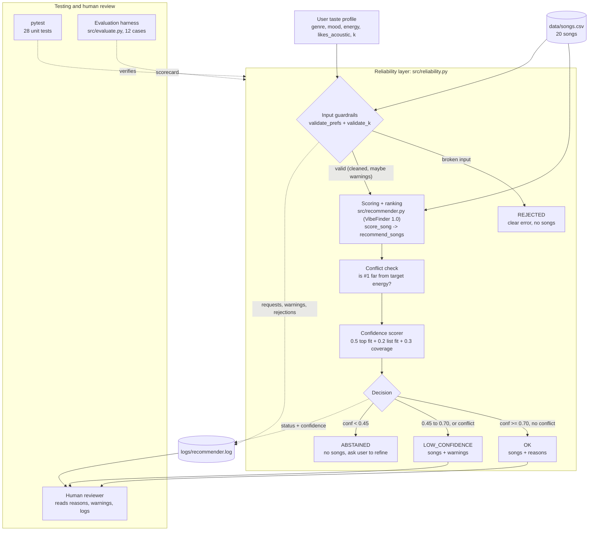

# 🎵 VibeFinder 2.0: A Music Recommender That Knows When It's Wrong

VibeFinder 2.0 recommends songs from a taste profile and explains every pick. It also checks its own work: it rejects broken input, warns when your taste isn't in the catalog, catches conflicting preferences, gives every list a confidence score, and refuses to recommend when it would only be guessing.

## Base Project

**Original project: Music Recommender Simulation (Module 3), "VibeFinder 1.0."** It was a content-based recommender that scored a 20-song catalog against a user's favorite genre, mood, target energy, and acoustic preference, then printed the top *k* songs with plain-English reasons. Its model card documented several failures: it gave no warning for genres not in the catalog (k-pop), it put a 0.30-energy song at #1 for a "sad but energy 0.9" listener, and it never said how much to trust a list. The original README is preserved at [`docs/project3_README.md`](docs/project3_README.md).

## Why This Matters

VibeFinder 1.0 always returned five songs with the same confidence, whether the match was perfect or meaningless. A recommender that answers confidently when it shouldn't trains users to stop trusting it. Version 2.0 turns the failures I found in Project 3 into checks the system runs on every request.

## The AI Feature: A Reliability and Testing System

Built into the main recommendation path (`src/reliability.py`). Every profile run by `src/main.py` goes through it.

| Step | What it does | Project 3 problem it fixes |
|---|---|---|
| **Input guardrails** | Rejects energy outside 0-1 or not a number, empty profiles, non-text genres, k outside 1-10. Cleans input (`"  LoFi "` becomes `lofi`, `"yes"` becomes `True`). | Bad input used to run silently or crash |
| **Catalog warnings** | Warns when a genre or mood isn't in the catalog, or when no genre or mood was given. | "Silent failure on unknown genres" |
| **Conflict check** | Flags when the #1 song is 0.40 or more away from the target energy. | "Conflicting preferences break it" (Sad but Hyped) |
| **Confidence score** | 0-1 score: `0.5 × top fit + 0.2 × list fit + 0.3 × catalog coverage`. | No way to tell a great list from filler |
| **Decision** | 0.70 or higher with no conflict returns **OK**. 0.45 to 0.70, or any conflict, returns **LOW_CONFIDENCE** (songs plus warnings). Below 0.45 returns **ABSTAINED** (no songs). | Always returned 5 songs |
| **Logging** | Every request, warning, rejection, and decision goes to `logs/recommender.log`. | No record of what happened |
| **Evaluation harness** | `src/evaluate.py` runs 12 predefined cases and prints a pass/fail scorecard, plus the reason for every failure. | Only manual checks before |

**Stretch feature attempted:** Test Harness / Evaluation Script (`src/evaluate.py`), shown under [Reliability and Guardrail Results](#reliability-and-guardrail-results).

## Architecture Overview

Diagram source: [`diagrams/architecture.mmd`](diagrams/architecture.mmd). The same diagram is embedded below so it renders on GitHub.



A request flows **input guardrails → scoring (VibeFinder 1.0's `recommend_songs`, unchanged) → conflict check → confidence scorer → decision**. The catalog feeds both the scorer and the guardrails, which need to know which genres and moods exist. Logging records each step. Humans stay in the loop in three places. Every song shows the reasons behind its score. LOW_CONFIDENCE results come with warnings a person can judge. The pytest suite and evaluation harness check the system's behavior before any change ships.

```
src/
  recommender.py   scoring + ranking (from Project 3, unchanged)
  reliability.py   NEW: guardrails, conflict check, confidence, decision, logging
  main.py          CLI, now routed through the reliability layer
  evaluate.py      NEW: evaluation harness (12 cases)
tests/
  test_recommender.py   8 tests from Project 3
  test_reliability.py   NEW: 20 tests for the reliability layer
data/songs.csv     20-song catalog
logs/              saved run outputs, test results, sample log
diagrams/          Mermaid architecture source
docs/              original Project 3 README
```

## Setup Instructions

Requires Python 3.10+.

```bash
git clone https://github.com/Cintraa/applied-ai-system-final.git
cd applied-ai-system-final
python -m venv .venv
source .venv/bin/activate          # Mac / Linux / Git Bash
.\.venv\Scripts\Activate.ps1       # Windows PowerShell
python -m pip install --upgrade pip
pip install -r requirements.txt     # only pytest; the app itself uses the standard library
```

Run it:

```bash
python -m src.main                                     # all 10 profiles through the reliability layer
python -m src.main --profile "Ghost Genre (k-pop)"     # one profile
python -m src.main --genre lofi --mood chill --energy 0.35 --acoustic yes   # your own profile
python -m src.main --experiment                        # Project 3 weight-shift experiment
python -m src.evaluate                                 # evaluation scorecard
python -m pytest -v                                    # 28 unit tests
```

## Sample Interactions

Every block below is the exact terminal output of the command shown. The output for all 10 built-in profiles is in [`logs/sample_run_all_profiles.txt`](logs/sample_run_all_profiles.txt).

**1. Clear profile with messy input: cleaned, confident, explained**

The guardrail cleans `"  LoFi "`, `CHILL`, `'0.35'`, and `yes` before scoring (see the `Cleaned:` line). Every song shows the reasons behind its score.

```
$ python -m src.main --genre "  LoFi " --mood CHILL --energy 0.35 --acoustic yes --k 3
Loaded songs: 20

================================================================
Profile: Custom
Prefs:   genre=  LoFi  | mood=CHILL | energy='0.35' | likes_acoustic=yes
Cleaned: genre=lofi | mood=chill | energy=0.35 | likes_acoustic=True
Status:  OK   Confidence: 0.97
         Recommendations ready.
----------------------------------------------------------------
#1  Library Rain - Paper Lanterns               Score: 4.93 / 5.00
      - genre match: lofi (+2.00)
      - mood match: chill (+1.00)
      - energy 0.35 vs target 0.35 (+1.50)
      - acoustic sound fit (+0.43)
#2  Midnight Coding - LoRoom                    Score: 4.75 / 5.00
      - genre match: lofi (+2.00)
      - mood match: chill (+1.00)
      - energy 0.42 vs target 0.35 (+1.40)
      - acoustic sound fit (+0.35)
#3  Focus Flow - LoRoom                         Score: 3.81 / 5.00
      - genre match: lofi (+2.00)
      - energy 0.40 vs target 0.35 (+1.42)
      - acoustic sound fit (+0.39)
```

**2. Genre not in the catalog: warns and lowers confidence** (in Project 3 this failed silently)

```
$ python -m src.main --profile "Ghost Genre (k-pop)"
Loaded songs: 20

================================================================
Profile: Ghost Genre (k-pop)
Prefs:   genre=k-pop | mood=happy | energy=0.70
Status:  LOW_CONFIDENCE   Confidence: 0.50
         Weak or conflicting match. Treat these as suggestions, not picks.
  ! genre 'k-pop' is not in the catalog, so no song can earn genre points
----------------------------------------------------------------
#1  Rooftop Lights - Indigo Parade              Score: 2.41 / 4.50
      - mood match: happy (+1.00)
      - energy 0.76 vs target 0.70 (+1.41)
#2  Sunrise City - Neon Echo                    Score: 2.32 / 4.50
      - mood match: happy (+1.00)
      - energy 0.82 vs target 0.70 (+1.32)
#3  Night Drive Loop - Neon Echo                Score: 1.43 / 4.50
      - energy 0.75 vs target 0.70 (+1.42)
#4  Concrete Verses - Blockline                 Score: 1.38 / 4.50
      - energy 0.78 vs target 0.70 (+1.38)
#5  Fuego Lento - Los Satelites                 Score: 1.35 / 4.50
      - energy 0.80 vs target 0.70 (+1.35)
```

**3. Conflicting preferences: caught by the conflict check**

Genre and mood both match, so the raw score looks fine (3.60/4.50). The conflict check sees that the #1 song is 0.60 away from the requested energy and downgrades the result.

```
$ python -m src.main --profile "Sad but Hyped (conflict)"
Loaded songs: 20

================================================================
Profile: Sad but Hyped (conflict)
Prefs:   genre=folk | mood=sad | energy=0.90
Status:  LOW_CONFIDENCE   Confidence: 0.78
         Weak or conflicting match. Treat these as suggestions, not picks.
  ! preferences conflict: #1 'Paper Boats' matches your labels but its energy 0.30 is 0.60 away from your target 0.90
----------------------------------------------------------------
#1  Paper Boats - The Quiet Pines               Score: 3.60 / 4.50
      - genre match: folk (+2.00)
      - mood match: sad (+1.00)
      - energy 0.30 vs target 0.90 (+0.60)
#2  Storm Runner - Voltline                     Score: 1.49 / 4.50
      - energy 0.91 vs target 0.90 (+1.48)
#3  Gym Hero - Max Pulse                        Score: 1.46 / 4.50
      - energy 0.93 vs target 0.90 (+1.46)
#4  Pulse Reactor - KYRO                        Score: 1.43 / 4.50
      - energy 0.95 vs target 0.90 (+1.43)
#5  Iron Cathedral - Grave Signal               Score: 1.40 / 4.50
      - energy 0.97 vs target 0.90 (+1.40)
```

**4. Nothing matches: the system abstains instead of guessing**

```
$ python -m src.main --profile "Nonsense Taste (polka/spooky)"
Loaded songs: 20

================================================================
Profile: Nonsense Taste (polka/spooky)
Prefs:   genre=polka | mood=spooky | energy=0.50
Status:  ABSTAINED   Confidence: 0.23
         Not confident enough to recommend anything. Try a genre or mood from the catalog.
  ! genre 'polka' is not in the catalog, so no song can earn genre points
  ! mood 'spooky' is not in the catalog, so no song can earn mood points
----------------------------------------------------------------
  (no songs returned)
```

**5. Broken input: rejected by the guardrail**

```
$ python -m src.main --profile "Broken Input (energy 1.7)"
Loaded songs: 20

================================================================
Profile: Broken Input (energy 1.7)
Prefs:   genre=pop | mood=happy | energy=1.70
Status:  REJECTED   Confidence: 0.00
         Request rejected: energy must be between 0 and 1, got 1.7
----------------------------------------------------------------
  (no songs returned)

$ python -m src.main --genre pop --energy loud
Loaded songs: 20

================================================================
Profile: Custom
Prefs:   genre=pop | energy='loud'
Status:  REJECTED   Confidence: 0.00
         Request rejected: energy must be a number from 0 to 1, got 'loud'
----------------------------------------------------------------
  (no songs returned)
```

## Reliability and Guardrail Results

**Unit tests:** `python -m pytest -v`, **28 passed** (8 from Project 3 + 20 new). Full list: [`logs/test_results.txt`](logs/test_results.txt).

```
$ python -m pytest -q
............................                                             [100%]
28 passed in 0.03s
```

**Evaluation harness (stretch feature):** `python -m src.evaluate` runs 12 predefined cases. Each case checks the decision status *and* a behavior check written from the listener's point of view. Any failure prints the reason. Saved copy: [`logs/eval_results.txt`](logs/eval_results.txt).

```
$ python -m src.evaluate
#   Case                                        Expected        Got             Conf  Result
----------------------------------------------------------------------------------------------
1   Default Pop/Happy                           ok              ok              0.91  PASS
2   Chill Lofi                                  ok              ok              0.94  PASS
3   Deep Intense Rock                           ok              ok              0.90  PASS
4   Messy input is cleaned ('  LoFi ', 'CHILL') ok              ok              0.94  PASS
5   Sad but Hyped (conflict)                    low_confidence  low_confidence  0.78  PASS
6   Ghost Genre (k-pop)                         low_confidence  low_confidence  0.50  PASS
7   Nonsense taste (polka/spooky)               abstained       abstained       0.23  PASS
8   Energy out of range (1.7)                   rejected        rejected        0.00  PASS
9   Energy not a number ('loud')                rejected        rejected        0.00  PASS
10  Empty profile                               rejected        rejected        0.00  PASS
11  Too many songs (k=50)                       rejected        rejected        0.00  PASS
12  Similar label: indie pop fan wants 'pop'    ok              ok              0.91  FAIL
----------------------------------------------------------------------------------------------
11/12 cases passed | average confidence (non-rejected): 0.76
  FAIL case 12: status was right, but behavior check failed: wanted #2 is Rooftop Lights (happy indie pop); got top 3 = Sunrise City, Gym Hero, Rooftop Lights
```

**Sample log.** Every request, warning, rejection, and decision is written to `logs/recommender.log`. Excerpt from [`logs/sample_recommender.log`](logs/sample_recommender.log):

```
2026-11-18 02:40:59,643 INFO request prefs={'genre': 'folk', 'mood': 'sad', 'energy': 0.9} k=5
2026-11-18 02:40:59,643 WARNING conflict check: preferences conflict: #1 'Paper Boats' matches your labels but its energy 0.30 is 0.60 away from your target 0.90
2026-11-18 02:40:59,643 INFO decision=low_confidence confidence=0.78 returned=5
2026-11-18 02:40:59,645 INFO request prefs={'genre': 'k-pop', 'mood': 'happy', 'energy': 0.7} k=5
2026-11-18 02:40:59,645 WARNING guardrail warning: genre 'k-pop' is not in the catalog, so no song can earn genre points
2026-11-18 02:40:59,645 INFO decision=low_confidence confidence=0.50 returned=5
2026-11-18 02:40:59,647 INFO request prefs={'genre': 'metal', 'mood': 'angry', 'energy': 0.95, 'likes_acoustic': True} k=5
2026-11-18 02:40:59,647 INFO decision=ok confidence=0.83 returned=5
2026-11-18 02:40:59,649 INFO request prefs={'energy': 0.5} k=5
2026-11-18 02:40:59,649 WARNING guardrail warning: no genre or mood given, so the list is ranked by energy alone
2026-11-18 02:40:59,649 INFO decision=ok confidence=0.83 returned=5
2026-11-18 02:40:59,651 INFO request prefs={'genre': 'polka', 'mood': 'spooky', 'energy': 0.5} k=5
2026-11-18 02:40:59,651 WARNING guardrail warning: genre 'polka' is not in the catalog, so no song can earn genre points
2026-11-18 02:40:59,651 WARNING guardrail warning: mood 'spooky' is not in the catalog, so no song can earn mood points
2026-11-18 02:40:59,651 INFO decision=abstained confidence=0.23 returned=0
2026-11-18 02:40:59,652 INFO request prefs={'genre': 'pop', 'mood': 'happy', 'energy': 1.7} k=5
2026-11-18 02:40:59,652 WARNING REJECTED by input guardrail: energy must be between 0 and 1, got 1.7
```

## Testing Summary

- **What worked:** All 28 unit tests pass, including the 8 original Project 3 tests, so the reliability layer didn't break the base recommender. All 4 broken inputs were rejected with clear messages. The two adversarial profiles from Project 3 that failed silently (Ghost Genre, Sad but Hyped) are now flagged LOW_CONFIDENCE with an explanation, and a nonsense profile abstains at 0.23.
- **What didn't:** Case 12 fails. A happy-pop listener at energy 0.76 still gets *Gym Hero* (pop, intense) at #2 instead of *Rooftop Lights* (indie pop, happy), at **0.91 confidence**. This is the "genre label beats actual vibe" problem from Project 3, and the reliability layer can't see it. Every score is high, so the system is confident.
- **What I learned:** Confidence measures how well songs fit *the scoring rule*, not whether the scoring rule matches what the listener wants. Guardrails catch broken input and missing data, but they can't catch a design flaw in the weights. Only a test written from the user's point of view caught it.

## Design Decisions and Trade-offs

- **Wrap the Project 3 scorer instead of rewriting it.** `recommender.py` is unchanged, and its 8 tests still pass. The reliability layer sits around it, so either part can change on its own.
- **Abstaining is allowed.** Returning nothing beats returning confident nonsense. The cost is that some users get no songs and have to rephrase.
- **Warn, don't reject, for unknown genres.** A typo or a missing genre shouldn't crash the app, but the user should know why the results are weak.
- **A conflict always downgrades to LOW_CONFIDENCE, even at 0.78.** Sad but Hyped's numbers look decent because genre and mood match. A separate rule was needed because the average hides the problem.
- **No artist-diversity cap.** In this catalog, a one-song-per-artist cap would push *Focus Flow* (LoRoom) out of the Chill Lofi list, even though it's a real lofi match. The filter-bubble problem here comes from energy, not artists, so the cap would make results worse.
- **Thresholds (0.70 and 0.45)** were tuned on these 20 songs and 12 cases. A bigger catalog would need retuning.

## Reflection

Project 3 taught me that a recommender is "score everything, then sort." This project taught me that the harder question is *when not to answer*. The best part of the work wasn't new scoring logic. It was turning the failures I had written down in my Project 3 model card into checks the system runs on every request. The failing evaluation case taught me the most: a system can be 91% confident and still wrong, because confidence only measures what you thought to measure.

Responsible-AI reflection, limitations, and AI collaboration notes: [`model_card.md`](model_card.md).

## Portfolio

**Code:** https://github.com/Cintraa/applied-ai-system-final

**What this project says about me as an AI engineer:** I care about whether an AI system deserves trust, not just whether it produces output. I took the failures I documented in my own Project 3 and turned them into guardrails, a confidence score, an abstain option, and an evaluation harness. I also kept a failing case in the final scorecard, because hiding it would make the system look better than it is. I want to build tools that explain their decisions, say "I'm not sure" when they should, and come with evidence that someone else can rerun.
