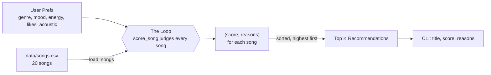

# 🎵 Music Recommender Simulation

## Project Summary

**VibeFinder 1.0** is a small, content-based music recommender I built to understand how apps like Spotify or TikTok decide what to play next. It loads a 20-song catalog from `data/songs.csv`, compares every song to a user's "taste profile" (favorite genre, favorite mood, target energy, and whether they like acoustic sound), gives each song a score with a list of reasons, and prints the top *k* songs in the terminal.

The goal was not to beat Spotify. It was to see, step by step, how plain data turns into something that *feels* like a personal recommendation, and where that process quietly goes wrong (bias, filter bubbles, and a small dataset).

---

## How The System Works

### How real recommenders do it

Big platforms mix two ideas. **Collaborative filtering** uses other people's behavior: if listeners who replay the same songs as me also love a track I've never heard, it gets suggested to me, even if the system knows nothing about how the song sounds. **Content-based filtering** uses the song itself: genre, mood, tempo, energy, valence, acousticness, and (at Spotify's scale) audio embeddings and lyrics. Real systems use both, plus a huge amount of behavior data: explicit signals like likes, follows, and playlist adds, and implicit signals like skips, replays, how long you listen, and time of day. They usually work in two stages: first pull a few hundred candidates out of millions, then rank those candidates with a model trained on what people actually ended up playing.

My version keeps only the content-based part. There are no other users, so there is no collaborative filtering. Instead, it focuses on the core loop every recommender shares: **score each song, then rank the scores.** It puts *who the song is* (genre) first, *how it feels* (mood) second, and *how intense it is* (energy) as a smooth tiebreaker that rewards songs that are **close** to what I want, not just louder.

### Features used

**`Song`** (one row of `data/songs.csv`)

| Feature | Type | Used in score? |
|---|---|---|
| `genre` | text | ✅ exact match |
| `mood` | text | ✅ exact match |
| `energy` | 0.0–1.0 | ✅ closeness to target |
| `acousticness` | 0.0–1.0 | ✅ if the user has an acoustic preference |
| `tempo_bpm`, `valence`, `danceability` | numbers | ❌ loaded, not scored yet (future work) |
| `id`, `title`, `artist` | identifiers | ❌ display only |

**`UserProfile`** (taste profile)

| Field | Dict key used by `score_song` | Example |
|---|---|---|
| `favorite_genre` | `genre` | `"pop"` |
| `favorite_mood` | `mood` | `"happy"` |
| `target_energy` | `energy` | `0.8` |
| `likes_acoustic` | `likes_acoustic` (optional) | `False` |

Every key is optional, so I can also test weird profiles (for example, energy only).

### Algorithm Recipe

**Scoring Rule (judges one song):**

| Rule | Points |
|---|---|
| Genre matches (case-insensitive) | **+2.0** |
| Mood matches (case-insensitive) | **+1.0** |
| Energy closeness | **+1.5 × (1 − \|song energy − target energy\|)** |
| Acoustic fit | **+0.5 × acousticness** if the user likes acoustic, **+0.5 × (1 − acousticness)** if not |

The best possible score is **5.0** when all four preferences are set. Every rule that fires adds a reason string like `genre match: pop (+2.00)`, so each recommendation explains itself.

Why these weights:
- **Genre (2.0) > mood (1.0):** genre is the strongest identity signal. Someone who wants lofi almost never wants metal, even if both are "focused." Mood shifts more from day to day.
- **Energy uses distance, not raw value.** If I multiplied by raw energy, the loudest song would always win. Using `1 − gap` means a song at 0.82 scores almost full points for a 0.80 target, while a 0.30 song scores much less. This lets the same rule serve chill users and gym users.
- **Energy (1.5) sits between genre and mood**, so a close energy match can push a no-genre song above a genre match with the wrong vibe, but only when the gap is large.
- **Acoustic (0.5) is a small nudge.** It separates "chill acoustic" from "chill electronic" without overriding everything else.

**Ranking Rule (orders the whole list):** score every song in the catalog with `score_song`, sort from highest to lowest (song title breaks ties so the output is always the same), and return the top *k*.

We need both rules because they answer different questions. The scoring rule asks, "How good is *this one* song for this user?" The ranking rule asks, "Out of *everything*, which songs go first?" A score alone means nothing until you compare it against all the other scores.

### Data flow



In text: **Input** (user prefs plus CSV) → **Process** (loop over all 20 songs, and `score_song` returns `(score, reasons)` for each one) → **Output** (`sorted(...)` by score, slice `[:k]`, print).

### Dataset

The starter catalog had 10 songs across 7 genres. I added **10 songs** (ids 11–20) in genres and moods that weren't covered: hip-hop/confident, classical/peaceful, metal/angry, reggae/relaxed, country/nostalgic, r&b/romantic, edm/energetic, folk/sad, latin/playful, and blues/melancholic. Now there are **17 genres and 15 moods**, and energy runs from 0.18 to 0.97. I kept the same 10 columns so the `Song` dataclass and the tests didn't break. `danceability` and `acousticness` were already in the file.

### Profile check (can it tell "intense rock" from "chill lofi"?)

Yes. Even with genre and mood removed, the energy targets (0.90 vs 0.35) are far enough apart that the two lists don't share a single song (see `model_card.md`). The profile is still **narrow**, though. It has one genre and one mood, so someone who likes "pop *or* indie pop" or "happy *and* chill" can't express that. It also ignores tempo and valence completely.

### Biases I expected before coding

- **Genre gate:** at +2.0, genre could bury a great song that matches my mood and energy but is labeled differently (like "indie pop" vs "pop").
- **Catalog imbalance:** lofi has 3 songs, while most genres have 1. Lofi fans get a full list of real matches, and everyone else gets "filler."
- **Energy as filler:** every song gets *some* energy points, so when nothing else matches, the list becomes "whatever is closest in energy," whether or not it fits the vibe.

---

## Getting Started

### Setup

1. Create and activate a virtual environment:

   ```bash
   python -m venv .venv
   source .venv/bin/activate        # Mac / Linux / Git Bash
   .\.venv\Scripts\Activate.ps1     # Windows PowerShell
   ```

2. Install dependencies:

   ```bash
   pip install -r requirements.txt
   ```

3. Run the app:

   ```bash
   python -m src.main                         # all 8 test profiles, top 5 each
   python -m src.main --profile "Chill Lofi"  # one profile
   python -m src.main --k 3                   # change list length
   python -m src.main --experiment            # weight-shift experiment
   ```

### Running Tests

```bash
pytest
```

`tests/test_recommender.py` has 8 tests. They cover the OOP `Recommender`, CSV loading and number conversion, the score/reasons output, energy closeness (closer beats louder), case-insensitive genre matching, sorting and `k`, and the weight-shift experiment.

---

## Sample Recommendation Output

Default "pop/happy" profile (`python -m src.main --profile "Default Pop/Happy"`):

```
Loaded songs: 20

================================================================
Profile: Default Pop/Happy
Prefs:   genre=pop | mood=happy | energy=0.80
----------------------------------------------------------------
#1  Sunrise City - Neon Echo                    Score: 4.47 / 4.50
      - genre match: pop (+2.00)
      - mood match: happy (+1.00)
      - energy 0.82 vs target 0.80 (+1.47)
#2  Gym Hero - Max Pulse                        Score: 3.31 / 4.50
      - genre match: pop (+2.00)
      - energy 0.93 vs target 0.80 (+1.30)
#3  Rooftop Lights - Indigo Parade              Score: 2.44 / 4.50
      - mood match: happy (+1.00)
      - energy 0.76 vs target 0.80 (+1.44)
#4  Fuego Lento - Los Satelites                 Score: 1.50 / 4.50
      - energy 0.80 vs target 0.80 (+1.50)
#5  Concrete Verses - Blockline                 Score: 1.47 / 4.50
      - energy 0.78 vs target 0.80 (+1.47)
```

This matches what I'd expect. *Sunrise City* is the only song that is pop, happy, and around 0.8 energy, so it wins with 4.47 out of 4.50. The surprise is #2. *Gym Hero* is a workout track (mood: intense), but it still beats the happy *Rooftop Lights*, because +2.0 for "pop" outweighs +1.0 for "happy." I dig into this in the model card.

Outputs for all 8 profiles are in [`model_card.md`](model_card.md#7-evaluation).

---

## Experiments You Tried

### 1. Weight shift: double energy (1.5 → 3.0), halve genre (2.0 → 1.0)

`python -m src.main --experiment`

```
Loaded songs: 20

================================================================
Profile: Default Pop/Happy  (genre=pop | mood=happy | energy=0.80)
----------------------------------------------------------------
Rank  Baseline (genre 2.0, energy 1.5)    Experiment (genre 1.0, energy 3.0)
#1    Sunrise City (4.47)                 Sunrise City (4.94)
#2    Gym Hero (3.31)                     Rooftop Lights (3.88)
#3    Rooftop Lights (2.44)               Gym Hero (3.61)
#4    Fuego Lento (1.50)                  Fuego Lento (3.00)
#5    Concrete Verses (1.47)              Concrete Verses (2.94)

================================================================
Profile: High-Energy Pop  (genre=pop | mood=intense | energy=0.95 | likes_acoustic=False)
----------------------------------------------------------------
Rank  Baseline (genre 2.0, energy 1.5)    Experiment (genre 1.0, energy 3.0)
#1    Gym Hero (4.95)                     Gym Hero (5.42)
#2    Sunrise City (3.71)                 Storm Runner (4.33)
#3    Storm Runner (2.89)                 Sunrise City (4.02)
#4    Pulse Reactor (1.99)                Pulse Reactor (3.49)
#5    Iron Cathedral (1.96)               Iron Cathedral (3.42)

================================================================
Profile: Chill Lofi  (genre=lofi | mood=chill | energy=0.35 | likes_acoustic=True)
----------------------------------------------------------------
Rank  Baseline (genre 2.0, energy 1.5)    Experiment (genre 1.0, energy 3.0)
#1    Library Rain (4.93)                 Library Rain (5.43)
#2    Midnight Coding (4.75)              Midnight Coding (5.14)
#3    Focus Flow (3.81)                   Spacewalk Thoughts (4.25)
#4    Spacewalk Thoughts (2.85)           Focus Flow (4.24)
#5    Coffee Shop Stories (1.92)          Coffee Shop Stories (3.38)

================================================================
Profile: Deep Intense Rock  (genre=rock | mood=intense | energy=0.90 | likes_acoustic=False)
----------------------------------------------------------------
Rank  Baseline (genre 2.0, energy 1.5)    Experiment (genre 1.0, energy 3.0)
#1    Storm Runner (4.93)                 Storm Runner (5.42)
#2    Gym Hero (2.93)                     Gym Hero (4.38)
#3    Pulse Reactor (1.92)                Pulse Reactor (3.34)
#4    Iron Cathedral (1.88)               Iron Cathedral (3.27)
#5    Sunrise City (1.79)                 Sunrise City (3.17)

================================================================
Profile: Sad but Hyped (conflict)  (genre=folk | mood=sad | energy=0.90)
----------------------------------------------------------------
Rank  Baseline (genre 2.0, energy 1.5)    Experiment (genre 1.0, energy 3.0)
#1    Paper Boats (3.60)                  Paper Boats (3.20)
#2    Storm Runner (1.49)                 Storm Runner (2.97)
#3    Gym Hero (1.46)                     Gym Hero (2.91)
#4    Pulse Reactor (1.43)                Pulse Reactor (2.85)
#5    Iron Cathedral (1.40)               Iron Cathedral (2.79)

================================================================
Profile: Ghost Genre (k-pop)  (genre=k-pop | mood=happy | energy=0.70)
----------------------------------------------------------------
Rank  Baseline (genre 2.0, energy 1.5)    Experiment (genre 1.0, energy 3.0)
#1    Rooftop Lights (2.41)               Rooftop Lights (3.82)
#2    Sunrise City (2.32)                 Sunrise City (3.64)
#3    Night Drive Loop (1.43)             Night Drive Loop (2.85)
#4    Concrete Verses (1.38)              Concrete Verses (2.76)
#5    Fuego Lento (1.35)                  Fuego Lento (2.70)

================================================================
Profile: Acoustic Metalhead  (genre=metal | mood=angry | energy=0.95 | likes_acoustic=True)
----------------------------------------------------------------
Rank  Baseline (genre 2.0, energy 1.5)    Experiment (genre 1.0, energy 3.0)
#1    Iron Cathedral (4.49)               Iron Cathedral (4.96)
#2    Pulse Reactor (1.51)                Pulse Reactor (3.01)
#3    Gym Hero (1.50)                     Gym Hero (2.96)
#4    Storm Runner (1.49)                 Storm Runner (2.93)
#5    Fuego Lento (1.40)                  Sunrise City (2.70)

================================================================
Profile: Dead Center (energy only)  (energy=0.50)
----------------------------------------------------------------
Rank  Baseline (genre 2.0, energy 1.5)    Experiment (genre 1.0, energy 3.0)
#1    Island Time (1.47)                  Island Time (2.94)
#2    Velvet Hours (1.47)                 Velvet Hours (2.94)
#3    Dusty Backroads (1.43)              Dusty Backroads (2.85)
#4    Midnight Coding (1.38)              Midnight Coding (2.76)
#5    Focus Flow (1.35)                   Focus Flow (2.70)
```

**What changed**
- **Default Pop/Happy:** *Rooftop Lights* (indie pop, happy) jumped over *Gym Hero* (pop, intense). This is **more accurate** for a "happy" listener. Gym Hero only ranked high because of its genre label.
- **High-Energy Pop:** *Storm Runner* (rock, intense, 0.91) passed *Sunrise City* (pop, happy, 0.82). This also feels more accurate, since a high-energy listener cares more about intensity than the pop label.
- **Chill Lofi:** *Spacewalk Thoughts* (ambient, chill) passed *Focus Flow* (lofi, focused) by 0.01. It's a toss-up, and both fit.
- **Sad but Hyped:** *Paper Boats* (folk, sad, energy 0.30) stayed #1, but its lead shrank from 2.11 points to 0.23. One more nudge and the system would recommend metal to a sad-folk fan.
- **Deep Intense Rock, Ghost Genre, Dead Center:** same order, just bigger numbers. Where genre wasn't deciding anything, changing its weight did nothing.

**Verdict:** the shift made results **more vibe-accurate** for profiles where mood and genre disagreed (happy vs. intense pop). It was **just different, or worse,** where genre is the main thing the user cares about. With energy worth 3 points out of 5.5, the system starts to behave like an energy dial. I kept the original weights as the default and saved this set as `EXPERIMENT_WEIGHTS` in `recommender.py`.

### 2. Stress test with 8 profiles

Besides 4 normal listeners (Default Pop/Happy, High-Energy Pop, Chill Lofi, Deep Intense Rock), I wrote 4 **adversarial** profiles to try to trick the scoring:

| Profile | Trick | What happened |
|---|---|---|
| Sad but Hyped | folk + sad, but energy 0.9 | Returned a 0.30-energy sad folk song at #1, then 4 loud songs that aren't sad at all |
| Ghost Genre | asks for k-pop (not in catalog) | Genre points never fire, and it silently falls back to mood + energy with no warning |
| Acoustic Metalhead | metal, but likes_acoustic = True | The acoustic preference is basically ignored (+0.01), because no loud acoustic songs exist |
| Dead Center | energy 0.5 only, no genre/mood | Becomes "nearest energy," surfacing reggae/r&b/country songs no other profile ever sees |

---

## Limitations and Risks

- **Tiny catalog:** 20 songs, and 15 of 17 genres have exactly one song. After the genre match runs out, the rest of the list is filler.
- **Exact string matching:** "indie pop" ≠ "pop," and "sad" ≠ "melancholic." The system has no idea genres or moods can be related.
- **Over-favors genre:** a genre label is worth twice a mood match, so *Gym Hero* (intense workout pop) beats a happy song for a happy-pop user.
- **Same loud songs for everyone with high energy:** *Gym Hero, Storm Runner, Pulse Reactor,* and *Iron Cathedral* show up for pop, rock, metal, *and* sad-folk users.
- **No feedback loop:** it never learns from skips or replays, and it can't handle "I like two genres."
- **Ignores** tempo, valence, danceability, lyrics, language, and artist variety.

More detail is in the [model card](model_card.md).

---

## Reflection

[**Model Card**](model_card.md)

Building this showed me that a recommender is really two small pieces: a rule that turns one song into a number, and a sort. Everything that feels "smart" comes from which features you choose and how much each is worth. Changing one weight from 2.0 to 1.0 changed what a happy-pop listener hears at #2, and nothing else in the code moved. Real platforms use far more data and learned weights, but the core loop is the same: features in, scores out, sort, show the top. Having each recommendation print its own reasons was the most useful thing I built. It made every weird result easy to debug.

The bias part surprised me more than the code. My system never "decided" to favor anything, but because lofi has three songs and metal has one, a lofi fan gets three real matches while a metal fan gets one match and then EDM and pop. An imbalance in the dataset quietly turns into an imbalance in who gets good recommendations. At Spotify's scale, the same effect could keep pushing popular, well-labeled genres and make it harder for niche artists or listeners with mixed taste to be served well. That is a filter bubble built by accident.
